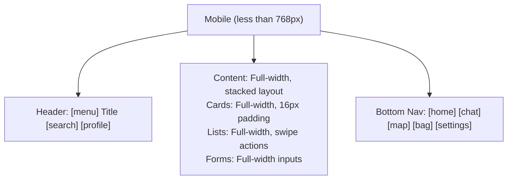

<!-- SPDX-License-Identifier: Apache-2.0 -->
<!-- SPDX-FileCopyrightText: 2026 Loop Lore Contributors -->

# EPIC: Accessibility & Input Systems

**Overview:** (see sections below)


**Status:** In Progress
**Status Note (2026-11-01, `p0-a11y-responsive`):** all 13 acceptance criteria now checked — the responsive-breakpoint slice (bottom sheets, trade grid, tier realignment, 44px targets) and the screen-reader navigation slice (live regions, h1 titles, single-main landmark, icon-button/asides labels, battle 1-9 + world focus + inventory arrow keynav) landed and are verified at the code level; what remains open is Phase 5 real-device/screen-reader testing, the help-overlay focus trap, and the touch-gesture ticket scope. Chat-page keynav consumers landed 2026-11-03 on `a11y-chat-keynav`: `scroll-down`/`scroll-up` → `#message-list`, `prev-chat`/`next-chat` → the visible chat list via `selectChat`, `goto-*` → the sidebar's own htmx navigation. Status stays In Progress for the remaining items.
**Priority:** P0 — Critical
**Effort:** High
**Type:** Feature Epic
**Tags:** accessibility, a11y, keyboard, mobile, responsive, touch

## Summary

Complete accessibility, keyboard navigation, and mobile support across all frontend pages. Ensures the application is usable by all users regardless of input method or ability.

## Core Features

### Keyboard Navigation

- Tab order management across all components
- Focus visible indicators (2px outline, high contrast)
- Escape to dismiss modals/popups
- Enter/Space to activate buttons
- Arrow keys for navigation in lists/grids
- Shortcut keys for common actions
- Skip links for main content

### Screen Reader Support

- ARIA labels on all interactive elements
- Live regions for dynamic content updates
- Semantic HTML structure (headings, landmarks)
- Alt text for images/icons
- Screen reader announcements for state changes

### Mobile Support

- Touch-friendly tap targets (44x44px minimum)
- Swipe gestures for navigation
- Pull-to-refresh where appropriate
- Bottom sheet for mobile modals
- Haptic feedback for actions
- Viewport meta tag configuration

### Responsive Design

- Breakpoints: <480px, 480-768px, 768-1200px, >1200px
- Fluid typography scaling
- Flexible grid layouts
- Mobile-first CSS approach
- Touch vs. mouse detection

## UI Components

### Focus Management System

```typescript
interface FocusManager {
  // Tab order tracking
  tabOrder: HTMLElement[];
  currentFocus: HTMLElement | null;

  // Focus trapping for modals
  trapFocus(container: HTMLElement,): void;
  releaseFocus(): void;

  // Skip links
  addSkipLink(target: HTMLElement, label: string,): void;

  // Focus restoration
  saveFocus(): void;
  restoreFocus(): void;
}
```

### Keyboard Shortcut System

```typescript
interface KeyboardShortcut {
  id: string;
  key: string;
  modifiers: ("ctrl" | "shift" | "alt" | "meta")[];
  action: () => void;
  description: string;
  context: "global" | "chat" | "battle" | "inventory";
}
```

### Touch Gesture System

```typescript
interface TouchGesture {
  id: string;
  type: "tap" | "swipe" | "pinch" | "long-press";
  direction?: "left" | "right" | "up" | "down";
  action: () => void;
  threshold: number; // pixels
  timeout: number; // ms for long-press
}
```

### Responsive Breakpoints

| Breakpoint | Behavior                               | Touch Targets   |
| ---------- | -------------------------------------- | --------------- |
| <480px     | Mobile: Full-width, stacked layout     | 44x44px minimum |
| 480-768px  | Tablet: Sidebar overlay, bottom sheets | 44x44px minimum |
| 768-1200px | Desktop: Side panels push content      | 32x32px minimum |
| >1200px    | Wide: Full layout with right panel     | 32x32px minimum |

### Mobile-Specific Patterns



### Desktop Keyboard Shortcuts

| Shortcut | Action             | Context         |
| -------- | ------------------ | --------------- |
| `Ctrl+N` | New chat           | Global          |
| `Ctrl+S` | Save current       | Global          |
| `Escape` | Close modal/cancel | Global          |
| `Enter`  | Confirm/submit     | Global          |
| `↑/↓`    | Navigate list      | Chat, Inventory |
| `←/→`    | Switch panels      | Chat            |
| `Ctrl+B` | Toggle sidebar     | Chat            |
| `Ctrl+I` | Open inventory     | Battle          |
| `Ctrl+M` | Open map           | World           |
| `1-9`    | Select action      | Battle          |

### Mobile Touch Gestures

| Gesture     | Action         | Context         |
| ----------- | -------------- | --------------- |
| Swipe left  | Delete/archive | Chat, Inventory |
| Swipe right | Reply/edit     | Chat            |
| Pull down   | Refresh        | Lists           |
| Long press  | Context menu   | Any item        |
| Pinch       | Zoom           | Map, Images     |
| Double tap  | Quick action   | Buttons         |

### Screen Reader Announcements

```html
<!-- Live region for dynamic updates -->
<div aria-live="polite" aria-atomic="true" class="sr-only">
  <!-- State changes announced here -->
  Message sent successfully Battle started with 3 enemies Location discovered: Darkwood
</div>

<!-- Status announcements -->
<div aria-live="assertive" aria-atomic="true" class="sr-only">
  <!-- Critical updates -->
  Error: Failed to save Network connection lost
</div>
```

### Focus Indicators

```css
/* Visible focus for keyboard users */
:focus-visible {
  outline: 2px solid var(--accent-primary);
  outline-offset: 2px;
}

/* High contrast mode support */
@media (prefers-contrast: high) {
  :focus-visible {
    outline: 3px solid currentColor;
    outline-offset: 3px;
  }
}

/* Reduced motion support */
@media (prefers-reduced-motion: reduce) {
  * {
    animation: none !important;
    transition: none !important;
  }
}
```

## Integration Points

### Shared Components

| Component | Accessibility Features         | Mobile Features        |
| --------- | ------------------------------ | ---------------------- |
| Modal     | Focus trap, Escape to close    | Bottom sheet on mobile |
| Dropdown  | Arrow key navigation           | Full-width on mobile   |
| Tab panel | Arrow key switching            | Swipe to switch tabs   |
| Table     | Row/column navigation          | Card view on mobile    |
| Form      | Label associations, validation | Full-width inputs      |
| Button    | Keyboard activation            | Touch targets 44x44px  |

### Page-Specific Accessibility

| Page      | Keyboard Features                  | Mobile Features             |
| --------- | ---------------------------------- | --------------------------- |
| Chat      | Message navigation, quick actions  | Bottom input, swipe actions |
| Battle    | Action shortcuts, turn navigation  | Large touch targets         |
| Inventory | Grid navigation, bulk actions      | Card view, swipe actions    |
| World     | Map navigation, location selection | Pinch zoom, touch map       |
| Settings  | Form navigation, save shortcuts    | Stacked form fields         |

## Acceptance Criteria

- [x] All interactive elements keyboard accessible
- [x] Visible focus indicators on all focusable elements
- [x] Tab order logical and predictable
- [x] Escape closes all modals/popups
- [x] Screen reader can navigate entire application
- [x] ARIA labels on all interactive elements
- [x] Live regions for dynamic content
- [x] Mobile touch targets 44x44px minimum
- [x] Swipe gestures for common actions
- [x] Responsive design at all breakpoints
- [x] Reduced motion support
- [x] High contrast mode support
- [x] No keyboard traps
- [x] Skip links for main content

## Implementation Phases

### Phase 1: Core Accessibility ✅ (2026-07-31)

- Focus management system (`src/frontend/alpine/focus.ts`)
- Keyboard navigation (tab order, escape key)
- ARIA labels on interactive elements
- Screen reader support (partial — live regions added)

### Phase 2: Mobile Support 🟡 Partial

- Touch gesture system — **wired into the chat message list (2026-10-25)**. `src/frontend/alpine/chat-touch-gestures.ts` attaches `src/frontend/touch.ts` (`onSwipe` / `onLongPress`) to `#message-list` with event delegation: swipe left → archive-confirm dialog, swipe right → edit, long-press → message context menu. Gestures dispatch the same actions the visible buttons use, attach only on touch-capable devices (pointer-coarse guard), no-op on buttons/inputs, and tear down cleanly across htmx swaps. Unit tests: `src/frontend/touch.test.ts`, `src/frontend/alpine/chat-touch-gestures.test.ts`. Remaining Phase 2 surface work (composer/sidebar gestures, pull-to-refresh, pinch zoom) stays tracked by `TASK-touch-gestures.md` and `WIRE-frontend-touch-swipe-gestures.md`.
- Input-mode tracker (`src/frontend/a11y/responsive.ts` — wired 2026-10-25 on branch `a11y-tracker-wiring`: started once per page load from `alpine/app.ts` init(), `body.touch-user`/`body.mouse-user` classes consumed by `responsive.css` hover-reveal overrides).
- Responsive breakpoints (complete 2026-11-01, `p0-a11y-responsive`: modal bottom sheets <480px, trade-window two-pane grid >=768px, `.world-page-columns` collapse realigned to the 768px tier, coarse-pointer 44px block extended to `.hamburger`/`.battle-action`/`.battle-combatant`, mobile-composer controls raised to 44px; the drawer sidebar and overlay right panel remain the documented intentional pattern on every tier — see `docs/frontend/chat/layout.md`)
- Mobile-specific patterns
- Touch target sizing (44px CSS in `app.css`)


### Phase 3: Keyboard Shortcuts 🟡 Partial → largely wired (2026-10-25, `a11y-keynav-phase3`)

Corrected history: an earlier read of this phase treated the shortcut surface as "missing";
audit found it built-but-unwired instead.

- Shortcut system — **existed, already wired** (corrected): `src/frontend/alpine/shortcuts.ts` registers a document keydown listener at bundle load (`src/frontend/alpine/index.ts` import chain), opt-in via the `keynav` localStorage flag; Ctrl+B/N/L/K always on, single-key + `g <key>` sequences dispatch `keynav:action` / `keynav:toggle-help` and feed `registerKeynavHandler`. Covered by `shortcuts.test.ts` + `shortcuts-listener.test.ts`.
- Shortcut help overlay — **existed but unwired; WIRED 2026-10-25**: `keynavHelp()` was registered nowhere and `src/components/chat/keynav-help.html` was included by no view (knip `epic-frontend-keynav-mobile` ignore). Now the overlay markup lives inline in `src/views/layout.html` inside the sidebar footer (the `{{> }}` include resolver only runs on view content, not the layout, so the include directive could not be used — the redundant partial was removed), with an aria-labelled help button gated on the `keynav` flag; Escape closes; `mobile-keynav.css` (previously referenced by nothing) is now linked from the layout. Component registered in the Alpine bundle and `window-types.ts`.
- Shortcut editor UI — **added 2026-10-25**: Settings → Keyboard tab (`settings/keynav.ts` submodule composed into `settingsPage()`), with the opt-in **toggle** (`setKeyboardNavEnabled` writes/clears the `keynav` localStorage flag — review finding: nothing had ever set the flag, leaving the surface unreachable; with the flag off the editor stays visible but inert), rebinding single-key/`g <key>`-pair combos, persisted to localStorage `keynav.keymap`, validated (`validateKeymapCombo`: no duplicates, no bare modifiers, `?`/`Escape`/`g` reserved, `g`-prefixed pairs only), reset-to-defaults; `getKeymap()` merges stored overrides over `DEFAULT_KEYMAP` and the keydown listener consumes the merged map. Action labels resolve through the alpine i18n module (`import { t } from "./i18n"`). Unit coverage: `shortcuts-overrides.test.ts`, `settings/keynav.test.ts`, `keynav-help.test.ts`.
- Context-specific shortcuts — **battle/inventory/world wired 2026-11-01** (`p0-a11y-responsive`): keymap grew `battle-slot-1..9` (digit keys, inert in inputs) whose handlers are registered on battle-panel mount and removed on destroy (`battle/panel-live.ts` selects the Nth enabled action-bar slot), plus `focus-inventory`/`focus-locations`/`focus-travel` (`g i`/`g l`/`g t`) registered in the world page's `init()` with cleanup; labels added for all 10 locales. Chat-page keynav consumers wired 2026-11-03 (`a11y-chat-keynav`): `src/frontend/alpine/chat-keynav.ts` registers the chat-page handlers on chat-page init and drops them on teardown (`scroll-down`/`scroll-up` → `#message-list`, `prev-chat`/`next-chat` → the visible chat list via `selectChat`), and `src/frontend/alpine/keynav-goto.ts` registers the `goto-*` consumers in the root Alpine component so they survive htmx swaps of `#app-root` (reusing the sidebar's own htmx navigation). The global document listener stays unwidened and still gates on the opt-in `keynav` flag.
- Editor i18n for non-en locales — **complete 2026-10-25**: all `frontend.keynav.*` + `common.actions` keys translated in ar/de/es/fr/ja/ko/pt/ru/zh; `bun run i18n:check` reports 9/9 locales complete.

### Phase 4: Advanced Features

- Screen reader optimizations — **landed 2026-11-01** (`p0-a11y-responsive`, closes TASK-screen-reader-support): persistent aria-live battle announcer (new `.sr-only` utility + `battle/panel-live.ts`, announces round/turn/battle end), polite live region on the SSE-driven world conditions strip, page-level `<h1>` titles on every main view header (was `<span class="title">`), nested-main fixed (`#app-root` no longer `role="main"` — each view's single `<main>` is the landmark), `aria-label`s mirrored onto icon-only header/sidebar/panel/message-action buttons and the nine unnamed right-panel asides, inventory item list keyboard navigation (up/down arrows with focus follow). Verified by code audit (landmarks, skip link, labels, live regions) — no real screen-reader pass yet (Phase 5)
- Keyboard shortcuts for power users — partially delivered by the Phase 3 rebind editor (2026-10-25); user-defined macro/context shortcuts remain open
- Help-overlay focus trap: the markup is keyboard-accessible (Escape close, Tab reaches controls) but `@alpinejs/focus` is not loaded, so the `x-trap` from the original WIRE design is not in effect — full focus trap + focus restore stays open under `WIRE-frontend-keyboard-help-overlay.md`

### Phase 5: Testing & Polish

- Accessibility audit
- Mobile testing
- Screen reader testing
- Keyboard-only testing

## Files to Create

- `src/frontend/a11y/focus-manager.ts` — Focus management
- `src/frontend/a11y/keyboard-shortcuts.ts` — Shortcut system
- `src/frontend/a11y/touch-gestures.ts` — Touch gesture system
- `src/frontend/a11y/screen-reader.ts` — Screen reader utils
- `src/frontend/a11y/responsive.ts` — Responsive utilities
- `src/frontend/a11y/a11y.css` — Accessibility styles
- `src/frontend/alpine/a11y.ts` — Alpine.js a11y logic

## Related Epics

- **All UI Epics** — Accessibility applies to all user-facing features
- **Epic Frontend Components** — Shared component accessibility
- **Epic Mobile Support** — Mobile-specific features

## Linked Tickets (Concrete Implementation)

| Phase | Ticket | Status |
| ----- | ------ | ------ |
| 1 — Core a11y (shipped 2026-07-31) | (folded into `src/frontend/alpine/focus.ts`) | shipped |
| 2 — Touch gestures | `TASK-touch-gestures.md` (also `TASK-frontend-touch-gestures.md` — done, `TASK-mobile-touch-gestures.md`, `WIRE-frontend-touch-swipe-gestures.md`) | chat message list wired 2026-10-25; composer/pinch/pull-to-refresh open |
| 2 — Mobile responsive breakpoints | `TASK-responsive-design.md` | done (breakpoint slice completed 2026-11-01) |
| 3 — Keyboard shortcuts | `TASK-keyboard-navigation.md` (core system done); overlay wired + rebind editor added 2026-10-25 via `a11y-keynav-phase3`; battle/inventory/world per-page keymaps wired 2026-11-01 (`p0-a11y-responsive`); chat-page action consumers wired 2026-11-03 (`a11y-chat-keynav`) | partially done — chat-page consumers delivered; Phase 5 real-device/screen-reader testing and the help-overlay focus trap remain open |
| 4 — Screen reader optimizations | `TASK-screen-reader-support.md` | done (core surfaces landed 2026-11-01; deep heading-level polish in settings/admin remains) |

**Gap (2026-09-23, resolved):** the then-open question of whether to file a touch-gesture ticket is moot — `TASK-touch-gestures.md` and three sibling tickets exist. The former wiring gap (`src/frontend/touch.ts` unimported, untested) was closed on the chat message list 2026-10-25 (see Phase 2); composer/sidebar gestures and pinch/pull-to-refresh remain open under the tickets above.
